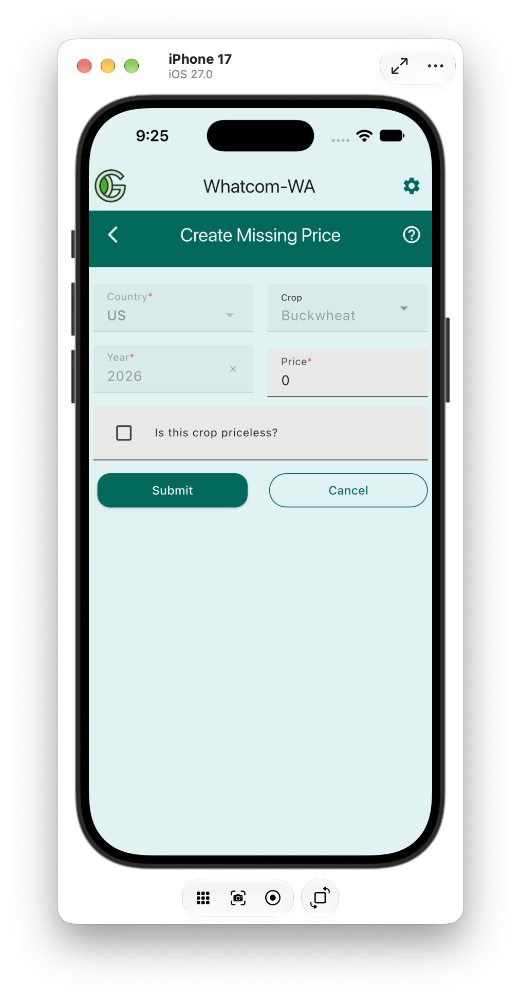

# Create Missing Price

The country, crop, and year fields are set based upon the missing price. The price field is an integer field that represents the price in cents. For example, if the price is $1.50, enter `150` in the price field. After filling out the form, click the `Submit` button to create the new price.

You can indicate that the crop is priceless by clicking the `Is this crop priceless?` checkbox. 

If you want to change a priceless crop back to a regular crop, go to the [Manage Existing Prices](manage_existing.md) screen and update the price.
