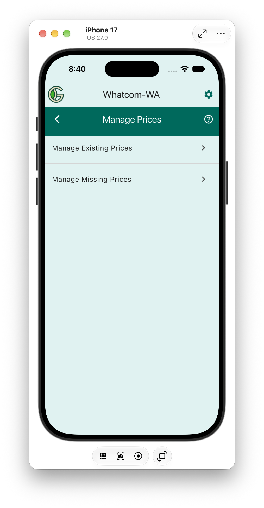

# Manage Prices

The Manage Prices allows you to:
* [Manage the existing prices](manage_existing) update, delete, or create new prices.
* See and create any missing prices. Crops with outcomes that have a quantity, but no price are shown in the "Missing Prices" screen. You can create a new price for any of these crops by clicking on the crop name.
