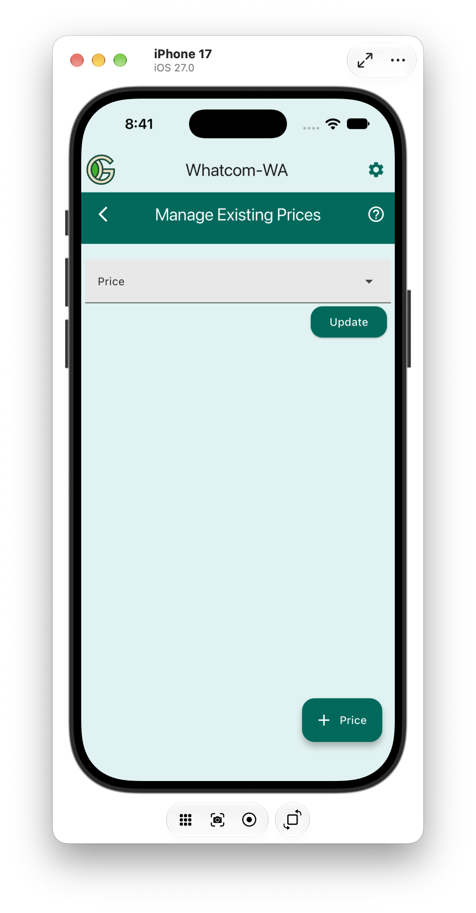

# Manage Existing Prices

The Manage Existing Prices page uses the standard GGC manage page layout. It has a dropdown menu to select the price to [update](update) or [delete](delete), and a `+ Price` button to [create](create) a new price.
